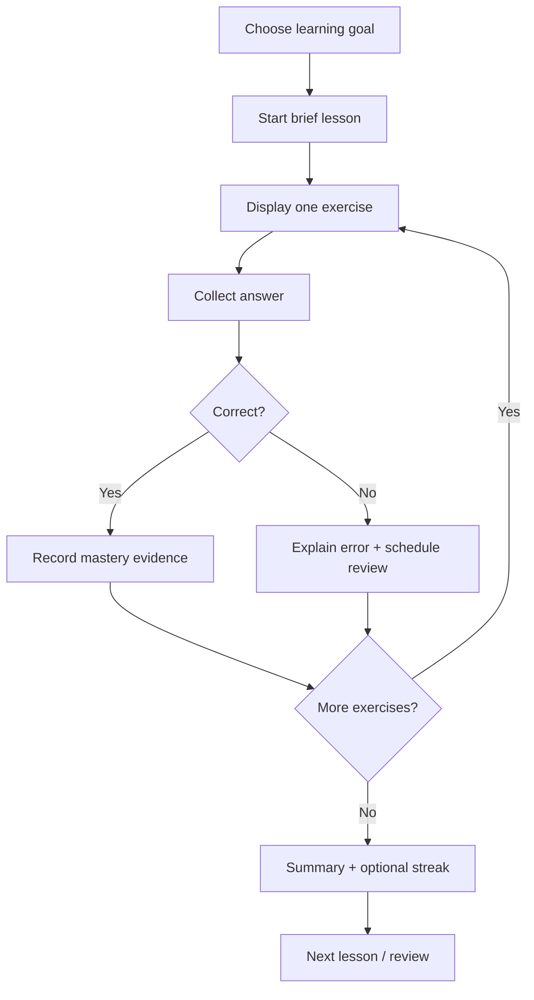

# Duolingo — REA investigation (phase 0: public evidence)

**Date:** 2026-10-18 (KST)
**Target:** Duolingo language-learning web experience and Android app
**Purpose:** Understand observable interaction patterns and propose an original business-English / question-forming training app (SpeakForward).
**Status:** Public product documentation review completed. **No REA runtime, APK decompilation, browser CDP capture, user-login interaction, or Codex execution occurred.** No APK or browser evidence artifact is in this repository.

## Source inventory (public first-party product descriptions)

| ID | First-party source | Confirmed / limitations |
|---|---|---|
| D1 | https://www.duolingo.com/ | Bite-sized lessons, personalized learning, language skills, points and levels |
| D2 | https://blog.duolingo.com/ko/types-of-lessons-in-duolingo/ | Learning path, new lessons, reviewing completed lessons, personalized practice, timed mini-games, AI calls (subscriber-related) |
| D3 | https://blog.duolingo.com/ko/how-duolingo-uses-ai/ | Course/exercise-bank description and learner-specific selection; proprietary algorithm details NOT observable |
| D4 | https://blog.duolingo.com/ko/how-duolingo-teaches-speaking/ | Speaking drills, conversation practice, review (feature availability may depend on course/plan) |
| D5 | https://www.duolingo.com/help/what-is-a-streak | Streak means days with lesson completion; reminders and freeze described |
| D6 | https://blog.duolingo.com/ko/duolingo-system/ | Duolingo described an Energy battery tested for a subset of learners, rather than assuming every account has Hearts |
| D7 | https://blog.duolingo.com/ko/duolingo-product-announcements/ | 2025 product highlights of conversational calls, feedback and social elements |
| D8 | https://blog.duolingo.com/ko/duolingo-learning-tips/ | New material and personalized review are distinct training activities |
| R1 | https://github.com/morluto/rea/blob/main/docs/browser-observation.md | REA browser/CDP read-only observation interface and evidence limits |
| R2 | https://github.com/morluto/rea/blob/main/docs/android-analysis.md | REA APK analysis support, required Java/JADX, release-dependent limitations |
| R3 | https://github.com/morluto/rea/blob/main/docs/adb-device-analysis.md | Read-only ADB device/package inspection and distinct state-changing methods |

## Function-level map — PUBLICLY DOCUMENTED (not reverse engineered)

| Capability | Visible learner behavior described by Duolingo | Original implementation concept | Verify in REA |
|---|---|---|---|
| Learning path | Ordered lesson units and progression | Business English: question building → auditor Q&A → overseas subsidiary calls | Screen hierarchy and completion gates |
| Short exercise | One activity at a time with immediate next step | 5–7 minute tasks, multiple-choice, sentence ordering, type-the-question | Content states, feedback transitions |
| Answer feedback | Exercises provide a correct/incorrect experience | Deterministic validation; teach correct word order and articles | Error and retry states |
| Listening | Short audio-centered training and radio lessons | Original TTS dialogues, transcript toggle | Audio control and accessible state |
| Speaking | Speech exercises, dedicated practice, optional advanced conversations | Browser mic practice and corrections, permission-aware | Mic permission UX and unavailable fallback |
| Personal practice | Review weak words/grammar and prior errors | Tag mistakes by `question_word_order`, `auxiliary_verb`, `tense`, `politeness` | Review-queue entry behavior |
| Streak | Consecutive learning days | Local-time completion date and streak without coercive penalties | Complete vs incomplete session rules |
| XP / progress | Earn experience, get visible milestones | Progress based on mastered phrases, not click count alone | Completion indicator and XP animation |
| Motivation limits | Historic Hearts and newer Energy experiment vary by cohort | **Do not clone scarcity/monetization.** Learners may continue practicing freely | Which system if any is visible on test account |
| AI conversation | Optional Duolingo Max conversation experiences | Original context-specific accounting/business roleplay, unique personas | Label paid-plan wall; no circumvention |

**Unverified facts**: exact native algorithms, endpoints, source-code architecture, latest account-specific UI, data schema, assessment model, precise point coefficients, retention metrics for current cohorts. Do not present product-level source descriptions as captured reverse-engineering evidence.

## Functional state machine (proposed ORIGINAL implementation, not Duolingo's source)

Proposed model:
- `Exercise(id, topic, kind, difficulty, prompt, answerCriterion, explanation, sourceLicense)`
- `Attempt(exerciseId, timestamp, response, result, errorTags, latencyMs)`
- `Skill(topic, masteryEstimate, lastAttemptAt, nextReviewAt)`
- `Session(startAt, completedAt, attemptedCount, errorCount)`
- `DailyCompletion(localDate, timezone, eligibleSessionId)`

Avoid sending unredacted learner voice recordings/transcripts to third-party analytics. Disclose speech backend and permissions.

## Fit with existing SpeakForward repo (code review via GitHub; not runtime testing)

`maincora44-wq/speakforward-opic` currently contains a static `index.html` app and README:
- **Existing:** a streak badge and localStorage daily practice state, speech recognition when supported, speech synthesis, rule-based English output analysis and OPIc/business English prompts.
- **Not established by this code inspection:** a persistent tagged error bank, automatic spaced-repetition selection, per-exercise quiz progression or a tested AI conversational tutor. Do not claim the existing UX has those capabilities.
- High-value next module: **Question Builder** with inversion `Do/Does/Did`, `Who/What/When/Where/Why/How`, polite requests `Could you ...?`, and audit/ICFR workplace contexts. Build original, authored training content, not copied Duolingo lesson data.

## Analysis boundaries and gaps

- Public official documentation is **feature evidence**, not REA output.
- The currently attached GitHub connector reads code but cannot run REA locally or attach to the user's Galaxy Fold/Chrome.
- An attempted npm registry check in the available execution environment returned `EAI_AGAIN` (network/DNS). Therefore REA was not installed or executed in this task.
- APK analysis requires an authorized app artifact/device and matching Java/JADX prerequisites; even then, a decompiled result is not permission to republish, copy or bypass protections.
- Do not attempt login bypass, paywall circumvention, unauthorized account access, copying Duolingo proprietary assets or data, or extracting credentials.

**Overall evidence grade:** Feature inventory = public-source supported; behavior trace = pending; program internals = unknown. Implementation plan = recommendation, **not implemented**.
